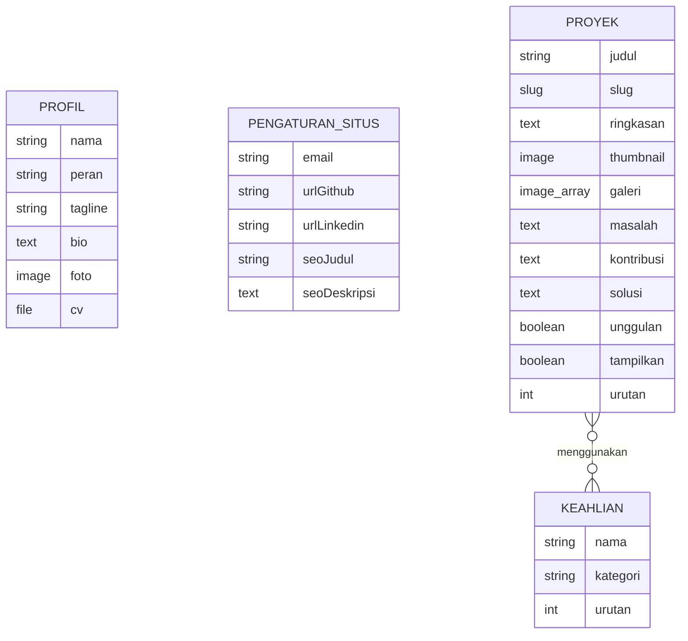

# Model Konten Sanity Studio — Portofolio Fajri Alamsyah

Tanggal Dokumen: 24 Oktober 2026  
Status: Spesifikasi Model Konten Resmi (Fase 0)  

Dokumen ini mendefinisikan struktur 4 (empat) jenis dokumen di Sanity Studio, tipe data, aturan validasi, relasi antar-dokumen, dan keterhubungannya dengan tampilan publik.

---

## 1. Arsitektur Dokumen & Hirarki

Sanity Studio akan mengelola 4 jenis dokumen dengan label dan panduan berbahasa Indonesia:

| Tipe Dokumen | Jenis Struktur | ID Tetap | Deskripsi |
| --- | --- | --- | --- |
| **Profil (`profil`)** | Singleton (Hanya 1 Dokumen) | `profil` | Data pribadi Fajri Alamsyah, bio, foto hero PNG, dan berkas CV PDF. |
| **Proyek (`proyek`)** | Collection (Daftar Dokumen) | Dinamis | Daftar studi kasus proyek yang pernah dibangun, tangkapan layar, dan link. |
| **Keahlian (`keahlian`)** | Collection (Daftar Dokumen) | Dinamis | Master keahlian teknologi yang dikelompokkan berdasarkan kategori. |
| **Pengaturan Situs (`pengaturanSitus`)** | Singleton (Hanya 1 Dokumen) | `pengaturanSitus` | Pengaturan global situs: kontak email, link media sosial, dan konfigurasi SEO dasar. |

---

## 2. Rincian Schema Dokumen

### A. Dokumen: Profil (`profil`)
- **Tipe:** `document` (Singleton)
- **Menu Label:** "Profil Pribadi"
- **Field:**
  1. `nama` (String, Wajib): Nama lengkap pemilik, nilai default: "Fajri Alamsyah".
  2. `peran` (String, Wajib): Jabatan / role profesional, nilai default: "Fullstack Developer".
  3. `sapaan` (String, Opsional): Sapaan pembuka di hero, default: "Halo, saya".
  4. `tagline` (String, Wajib): Kalimat ringkas di hero, default: "Membangun aplikasi web yang berguna, rapi, dan mudah digunakan."
  5. `bio` (Text, Wajib): Deskripsi diri lebih mendalam untuk section "Tentang Saya".
  6. `lokasi` (String, Opsional): Lokasi domisili yang ingin ditampilkan (misal: "Indonesia" atau kota domisili).
  7. `foto` (Image, Wajib):
     - Foto PNG berlatar transparan asli Fajri Alamsyah.
     - Validasi: Format gambar (PNG direkomendasikan untuk transparansi).
     - Subfield: `alt` (String, Wajib) - teks alternatif deskriptif untuk pembaca layar.
  8. `cv` (File, Wajib):
     - Berkas curriculum vitae dalam format PDF.
     - Validasi: Hanya menerima ekstensi `.pdf` (`application/pdf`).
     - Subfield: `namaFileTampil` (String, Opsional) - label nama unduhan yang rapi.

---

### B. Dokumen: Proyek (`proyek`)
- **Tipe:** `document` (Collection)
- **Menu Label:** "Daftar Proyek"
- **Field:**
  1. `judul` (String, Wajib): Nama proyek (misal: "Sistem Manajemen Inventaris").
  2. `slug` (Slug, Wajib, Unik):
     - Slug URL untuk studi kasus `/proyek/[slug]`.
     - Dibangkitkan otomatis dari `judul` dengan opsi `maxLength: 96`.
     - Validasi: Wajib diisi, karakter huruf kecil, angka, dan tanda hubung `-`.
  3. `ringkasan` (Text, Wajib): Penjelasan singkat 1-2 kalimat untuk kartu proyek di beranda dan halaman `/proyek`.
  4. `jenisProyek` (String, Wajib): Pilihan kategori pengerjaan:
     - `mandiri`: Proyek Mandiri / Personal
     - `pekerjaan`: Proyek Pekerjaan / Perusahaan
     - `klien`: Proyek Klien / Freelance
     - `open_source`: Kontribusi Open Source
  5. `thumbnail` (Image, Wajib):
     - Gambar sampul proyek (rasio 16:9 direkomendasikan).
     - Subfield: `alt` (String, Wajib) - teks alternatif gambar.
  6. `galeri` (Array of Image, Opsional):
     - Koleksi tangkapan layar fitur-fitur penting dalam studi kasus.
     - Masing-masing memuat subfield `alt` (wajib) dan `caption` (opsional).
  7. `masalah` (Text, Wajib): Narasi latar belakang atau kendala nyata yang ingin diselesaikan oleh proyek ini.
  8. `kontribusi` (Text, Wajib): Peran spesifik dan tanggung jawab pribadi Fajri dalam proyek tersebut.
  9. `solusi` (Text, Wajib): Arsitektur teknis, fitur utama, dan solusi implementasi yang dibangun.
  10. `hasil` (Text, Opsional): Dampak terukur atau hasil konkret proyek (HANYA diisi jika ada fakta nyata; biarkan kosong jika belum terukur).
  11. `keahlian` (Array of Reference to `keahlian`, Wajib):
      - Menghubungkan teknologi yang dipakai pada proyek ini dengan dokumen master keahlian.
  12. `urlDemo` (Url, Opsional): Tautan URL demo publik yang aktif (validasi protokol `http://` atau `https://`).
  13. `statusRepo` (String, Wajib): Ketersediaan kode sumber:
      - `public`: Repositori Publik (memerlukan `urlRepo`)
      - `private`: Repositori Privat (menampilkan keterangan repo privat)
      - `hidden`: Tidak Ditampilkan (sembunyikan tombol repositori)
  14. `urlRepo` (Url, Opsional): Tautan repositori (GitHub/GitLab) jika `statusRepo == 'public'`.
  15. `keteranganRepoPrivat` (String, Opsional): Teks penjelasan wajar jika kode bersifat privat (misal: "Kode sumber privat karena perjanjian kerahasiaan / proyek internal").
  16. `unggulan` (Boolean, Default `false`):
      - Jika dicentang (`true`), proyek ini memenuhi syarat untuk ditampilkan di halaman beranda (maksimal 3 proyek teratas).
  17. `tampilkan` (Boolean, Default `true`):
      - Mengontrol visibilitas publik proyek. Jika `false`, proyek tidak akan muncul di daftar publik maupun detail studi kasus.
  18. `urutan` (Number, Default `0`): Angka untuk menentukan urutan tampil proyek (angka terkecil tampil lebih awal).

---

### C. Dokumen: Keahlian (`keahlian`)
- **Tipe:** `document` (Collection)
- **Menu Label:** "Keahlian & Teknologi"
- **Field:**
  1. `nama` (String, Wajib): Nama teknologi atau alat (misal: "React", "Next.js", "TypeScript", "Node.js", "PostgreSQL", "Tailwind CSS", "Docker", "Git").
  2. `kategori` (String, Wajib): Kelompok keahlian:
     - `frontend`: Frontend Development
     - `backend`: Backend Development
     - `database`: Database & Penyimpanan
     - `tools`: Tools, DevOps & Lainnya
  3. `ikon` (String / Image, Opsional): Nama ikon atau aset grafis pendukung (jika diperlukan).
  4. `urutan` (Number, Default `0`): Prioritas urutan tampilan dalam kelompoknya.

---

### D. Dokumen: Pengaturan Situs (`pengaturanSitus`)
- **Tipe:** `document` (Singleton)
- **Menu Label:** "Pengaturan Situs & Kontak"
- **Field:**
  1. `email` (String, Wajib): Alamat email resmi untuk tautan tombol kontak (validasi format email).
  2. `urlGithub` (Url, Opsional): URL profil GitHub (misal: `https://github.com/username`).
  3. `urlLinkedin` (Url, Opsional): URL profil LinkedIn (misal: `https://linkedin.com/in/username`).
  4. `seoJudul` (String, Wajib): Judul standar website untuk metadata pencarian (misal: "Fajri Alamsyah — Fullstack Developer").
  5. `seoDeskripsi` (Text, Wajib): Deskripsi singkat situs (150-160 karakter) untuk meta description dan Open Graph.
  6. `ogImage` (Image, Opsional): Gambar pratinjau saat tautan website dibagikan di media sosial.
  7. `siteUrl` (Url, Opsional): Domain kanonikal produksi setelah website online.

---

## 3. Relasi Data & Mekanisme Pengambilan



### Mekanisme Draft vs Published
1. **Sanity Content Lake:**
   - Secara default, Sanity memisahkan dokumen dengan ID `drafts.<id>` (sedang diedit) dan `<id>` (sudah dipublish).
2. **Kueri Publik:**
   - Semua query dari Next.js App Router dikonfigurasi dengan:
     ```groq
     *[_type == "proyek" && tampilkan == true && !(_id in path("drafts.**"))] | order(urutan asc)
     ```
   - Ini menjamin draf yang belum ditekan tombol "Publish" tidak akan pernah bocor ke tampilan publik.
