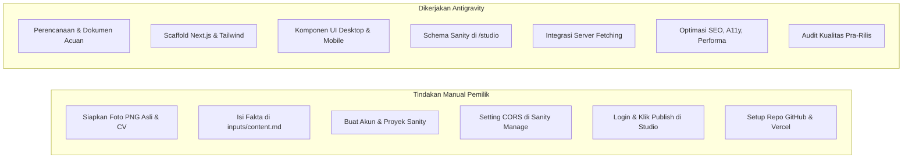

# Panduan Langkah Manual Pemilik (Manual Setup) — Portofolio Fajri Alamsyah

Tanggal Dokumen: 24 Oktober 2026  
Status: Panduan Aksi Manual (Fase 0)  

Dokumen ini memuat seluruh tindakan yang harus dikerjakan secara mandiri oleh Fajri Alamsyah (pemilik proyek) karena berkaitan dengan akun pribadi, otentikasi rahasia, penyediaan aset asli, dan otorisasi layanan.

---

## 1. Pedoman Keamanan Informasi (Sangat Penting)

> [!CAUTION]
> **JANGAN PERNAH MENGIRIMKAN TOKEN RAHASIA, PASSWORD, ATAU KODE OTP KE CHAT!**
> - Agent **tidak membutuhkan** password atau token rahasia Anda untuk membangun aplikasi.
> - `Project ID` dan `Dataset Name` adalah identitas publik proyek yang aman dimasukkan ke `.env.local` atau chat.
> - Kredensial rahasia (seperti Sanity Write Token atau kunci API rahasia lainnya) hanya Anda simpan sendiri di file `.env.local` atau dashboard hosting jika kelak dibutuhkan.

---

## 2. Inventaris & Penyiapan Aset Kerja Pribadi

Letakkan berkas asli Anda ke dalam folder `inputs/` yang sudah disediakan:

| Kebutuhan Aset | Lokasi Folder | Spesifikasi & Ketentuan | Status Saat Ini |
| --- | --- | --- | --- |
| **Foto Profil PNG** | `inputs/profile/` | Foto PNG berlatar transparan asli Fajri Alamsyah. Wajah, pakaian, pose, dan proporsi tubuh asli tanpa rekayasa AI. | `BELUM TERSEDIA` |
| **Berkas CV (PDF)** | `inputs/profile/` | File dokumen resume/CV terbaru berformat `.pdf`. | `BELUM TERSEDIA` |
| **Screenshot Proyek** | `inputs/projects/` | Gambar tangkapan layar antarmuka proyek nyata yang diizinkan untuk dipublikasikan (format JPG/PNG/WebP, rasio 16:9 disarankan). | `BELUM TERSEDIA` |
| **Referensi Desain** | `inputs/references/` | Screenshot desain yang dipilih atau hasil ekspor Stitch untuk panduan estetika. | `BELUM TERSEDIA` |
| **Fakta & Data Teks** | `inputs/content.md` | Salin dan isi template pada file `inputs/content.md` (profil, bio, keahlian nyata, dan narasi studi kasus proyek). | `TEMPLATE SIAP / DATA BELUM TERSEDIA` |

> [!NOTE]
> Pengerjaan **Fase 1** (Fondasi Next.js) dan **Fase 2** (UI Publik) tetap dapat dijalankan meskipun foto atau data belum lengkap. Agent akan menggunakan placeholder netral berlabel jelas untuk pengujian tata letak sementara.

---

## 3. Persiapan Akun & Proyek Sanity (Diperlukan Sebelum/Pada Fase 3)

Langkah-langkah yang perlu Anda lakukan sebelum integrasi CMS di Fase 3:

### Langkah 1: Pendaftaran Akun Sanity
1. Buka situs [https://www.sanity.io](https://www.sanity.io) di browser Anda.
2. Klik **Get Started** atau **Log In** menggunakan akun GitHub atau Google Anda.

### Langkah 2: Membuat Proyek Portofolio
1. Masuk ke dashboard Sanity Manage: [https://www.sanity.io/manage](https://www.sanity.io/manage).
2. Klik tombol **Create project**.
3. Beri nama proyek: `portfolio-fajri`.
4. Pilih paket gratis (**Free Tier** sudah sangat cukup untuk portofolio pribadi).
5. Pada pilihan dataset, pastikan memilih nama `production` dan tipe visibilitas **Public** (karena konten portofolio yang terbit memang ditujukan untuk dibaca oleh publik).

### Langkah 3: Mengambil Identitas Proyek
1. Di halaman ikhtisar proyek Sanity Manage, temukan dan salin:
   - **Project ID:** (string alfanumerik unik, misal: `a1b2c3d4`)
   - **Dataset:** `production`
2. Nilai ini nantinya akan Anda masukkan ke file `.env.local` saat Fase 3 dimulai.

### Langkah 4: Pengaturan CORS Origin Lokal
Agar Studio yang berjalan di komputer lokal Anda dapat mengakses Content Lake:
1. Di dashboard Sanity Manage, buka tab **API** > bagian **CORS Origins**.
2. Klik tombol **Add CORS origin**.
3. Masukkan origin lokal:
   - **Origin:** `http://localhost:3000` (atau port dev yang aktif).
   - **Credentials:** Centang kotak **Allow credentials** (wajib untuk login Studio).
4. Klik **Save**.

---

## 4. Pengisian & Publikasi Konten (Fase 5)

Setelah antarmuka admin di `/studio` selesai dibangun oleh agent pada Fase 3 & 4:
1. Buka browser ke alamat `http://localhost:3000/studio`.
2. Login menggunakan akun Sanity Anda sendiri.
3. Masukkan data profil Anda, unggah foto PNG asli dan berkas CV PDF.
4. Masukkan data keahlian dan studi kasus proyek Anda.
5. Klik tombol **Publish** di pojok kanan bawah editor Sanity untuk setiap dokumen yang siap ditampilkan.
6. Muat ulang halaman utama website `http://localhost:3000` untuk melihat perubahan yang langsung tampil.

---

## 5. Rangkuman Pembagian Tugas Pemilik vs Agent

