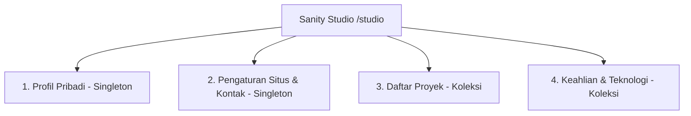
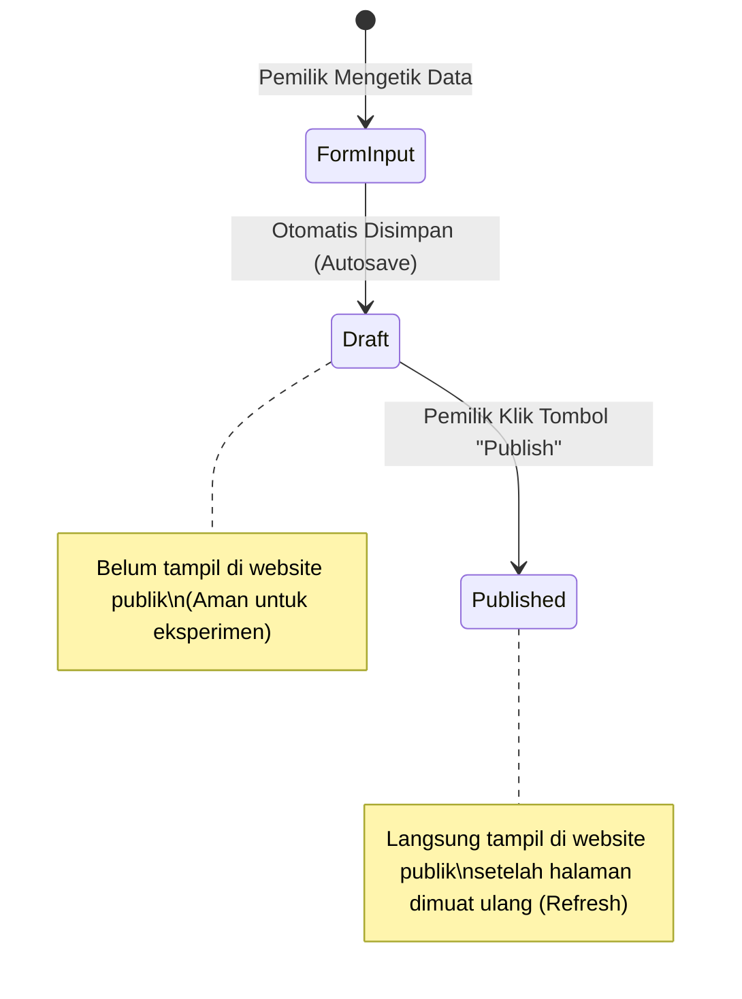

# Panduan Pengelolaan Konten (Admin Guide) — Portofolio Fajri Alamsyah

Dokumen ini adalah panduan resmi bagi Fajri Alamsyah untuk mengelola, memperbarui, menerbitkan, dan mencadangkan seluruh konten portofolio melalui antarmuka **Sanity Studio** di `/studio`.

---

## 1. Akses Admin & Autentikasi

* **Alamat Lokal:** [http://localhost:3000/studio](http://localhost:3000/studio)
* **Alamat Produksi (Setelah Rilis):** `https://domain-anda.com/studio`
* **Cara Masuk (Login):**
  1. Buka tautan `/studio` pada peramban web Anda.
  2. Klik penyedia login yang Anda gunakan saat mendaftar (misal: **Google** atau **GitHub**).
  3. Setelah terverifikasi, Anda akan langsung diarahkan ke panel navigasi **Manajemen Konten Portofolio**.

> [!NOTE]
> Rute `/studio` telah diamankan dengan aturan `robots: noindex, nofollow` sehingga mesin pencari seperti Google tidak akan mengindeks halaman login admin ini. Hanya akun yang terdaftar pada keanggotaan proyek Sanity Anda yang memiliki izin untuk mengubah data.

---

## 2. Struktur Menu & Formulir Konten

Antarmuka Studio terbagi menjadi 4 bagian menu utama yang berlabel Bahasa Indonesia:



### 1. Profil Pribadi (Singleton)
Dokumen ini bersifat tunggal (hanya ada satu di database) dan mengatur bagian Hero serta Tentang Saya:
* **Nama Lengkap:** Nama pemilik (standar: `Fajri Alamsyah`).
* **Peran / Profesi:** Profesi utama (standar: `Fullstack Developer`).
* **Sapaan Pembuka:** Teks kecil pembuka di atas nama (standar: `Halo, saya`).
* **Tagline Singkat:** Kalimat ringkas yang tampil menonjol pada Hero.
* **Biografi / Tentang Saya:** Paragraf editorial tentang perjalanan, dedikasi, dan pendekatan kerja Anda.
* **Lokasi / Domisili:** Opsional, misalnya `Indonesia` atau kota domisili Anda.
* **Foto Profil PNG (Hero):**
  * **Ketentuan:** Wajib berupa foto PNG asli Fajri Alamsyah dengan latar belakang transparan. Dilarang menggunakan foto hasil rekayasa AI.
  * **Teks Alternatif (Alt):** Wajib diisi untuk aksesibilitas pembaca layar (misal: *Foto potret Fajri Alamsyah, Fullstack Developer*).
* **Berkas CV (PDF):**
  * Unggah resume/CV terbaru dalam format `.pdf`.
  * Sistem website akan otomatis menambahkan tautan unduh langsung pada tombol **Unduh CV** di navigasi dan hero.

---

### 2. Pengaturan Situs & Kontak (Singleton)
Dokumen ini mengatur informasi kontak publik dan konfigurasi mesin pencari (SEO):
* **Alamat Email Publik:** Email tujuan untuk tombol kontak (otomatis menjadi tautan `mailto:`).
* **Tautan Profil GitHub:** URL lengkap repositori profil Anda (contoh: `https://github.com/username`).
* **Tautan Profil LinkedIn:** URL profil profesional LinkedIn Anda (contoh: `https://linkedin.com/in/username`).
* **Judul SEO Standar:** Judul yang tampil pada tab peramban dan hasil pencarian Google (standar: `Fajri Alamsyah — Fullstack Developer`).
* **Deskripsi SEO Standar:** Ringkasan 150–160 karakter untuk deskripsi cuplikan Google.
* **Gambar Pratinjau Sosial (Open Graph Image):** Gambar banner saat link website dibagikan ke WhatsApp, LinkedIn, atau media sosial.
* **Domain Produksi Website:** URL final setelah dipublikasikan online (contoh: `https://fajrialamsyah.com`).

---

### 3. Keahlian & Teknologi (Koleksi)
Gunakan menu ini untuk mendata teknologi yang Anda kuasai. Data ini nantinya dapat dipilih sebagai referensi teknologi di setiap kartu studi kasus proyek.
* **Nama Teknologi:** Contoh: `TypeScript`, `Next.js`, `Tailwind CSS`, `Node.js`, `PostgreSQL`, `Laravel`.
* **Kategori Keahlian:**
  * `Frontend Development`
  * `Backend Development`
  * `Database & Penyimpanan`
  * `Tools & DevOps`
* **Nomor Urutan Tampilan:** Angka lebih kecil akan tampil lebih dahulu dalam kelompoknya.

---

### 4. Daftar Proyek (Koleksi Studi Kasus)
Menu untuk menambah, menyunting, dan mengatur portofolio aplikasi yang telah Anda bangun:
* **Judul Proyek:** Nama aplikasi atau sistem web.
* **Slug URL:** Pengenal unik pada alamat website. Klik tombol **Generate** untuk membuatnya otomatis dari judul (misal: `sistem-layanan-informasi`).
* **Ringkasan Singkat:** 1–2 kalimat ringkas untuk pengantar kartu proyek.
* **Jenis Pengerjaan:** Pilihan antara `Pekerjaan / Perusahaan`, `Mandiri / Personal`, `Klien / Freelance`, atau `Open Source`.
* **Thumbnail / Sampul:** Gambar utama kartu proyek (disarankan rasio aspek 16:9) beserta **Alt Text**.
* **Galeri Tangkapan Layar (Opsional):** Koleksi screenshot fitur-fitur penting dalam studi kasus lengkap dengan caption.
* **Latar Belakang & Masalah:** Masalah nyata yang melatarbelakangi dibangunnya proyek ini.
* **Kontribusi Pribadi:** Peran, tanggung jawab, dan bagian sistem yang Anda kerjakan sendiri.
* **Solusi Teknis & Fitur Utama:** Arsitektur, alur data, atau fitur utama yang Anda implementasikan.
* **Hasil & Dampak (Opsional):** Hasil nyata yang dapat dibuktikan secara faktual (biarkan kosong jika belum ada metrik terukur).
* **Teknologi yang Digunakan:** Pilih dari daftar Keahlian yang telah dibuat sebelumnya.
* **Status Repositori Kode:**
  * `Publik:` Menampilkan tombol tautan ke repositori GitHub.
  * `Privat:` Menampilkan badge ramah bahwa kode sumber bersifat internal/milik klien tanpa tautan palsu.
  * `Sembunyikan:` Tidak menampilkan elemen status repositori sama sekali.
* **URL Demo Publik (Opsional):** Tautan langsung ke aplikasi aktif jika tersedia.
* **Tampilkan Sebagai Proyek Unggulan:** Jika dicentang, proyek akan masuk kandidat 3 proyek teratas di Beranda (`/`).
* **Publikasikan di Website:** Sakelar on/off untuk menampilkan atau menyembunyikan proyek dari seluruh halaman publik.
* **Nomor Urutan Tampilan:** Menentukan urutan kemunculan kartu pada halaman proyek.

---

## 3. Alur Kerja Konten: Membedakan Draft vs Publish

Sanity memisahkan status dokumen yang sedang disunting dengan dokumen yang telah terbit:



1. **Penyimpanan Otomatis (Draft):**  
   Saat Anda mengetik atau mengunggah gambar, Studio langsung menyimpan perubahan secara otomatis sebagai draf (*draft*). Perubahan berstatus draf **TIDAK AKAN** terlihat oleh pengunjung website publik karena lapisan kueri web hanya mengambil dokumen berstatus `published`.
2. **Penerbitan Konten (Publish):**  
   Untuk memunculkan perubahan ke website publik, klik tombol **Publish** berwarna hijau di pojok kanan bawah editor dokumen.
3. **Pembaruan Seketika (Tanpa Rebuild):**  
   Setelah menekan Publish, buka tab website publik [http://localhost:3000](http://localhost:3000) dan lakukan **Refresh** (`F5` atau `Ctrl + R`). Data terbaru akan langsung muncul berkat konfigurasi server-side fetching `cache: 'no-store'`.
4. **Menarik Konten dari Publik (Unpublish / Sembunyikan):**
   * **Cara 1 (Rekomendasi):** Matikan sakelar **Publikasikan di Website** (`tampilkan: false`) pada dokumen proyek, lalu klik **Publish**. Proyek akan tetap tersimpan di Studio tetapi hilang dari daftar publik.
   * **Cara 2:** Klik menu titik tiga di sebelah tombol Publish, lalu pilih **Unpublish**. Dokumen akan kembali menjadi draf murni.

---

## 4. Tabel Inventaris Konten & Status Kesiapan

Gunakan tabel ini sebagai acuan kelengkapan fakta portofolio Anda sebelum rilis publik:

| Kategori Data | Field / Elemen | Sumber Fakta | Status Kesiapan | Tindakan Pemilik |
| :--- | :--- | :--- | :--- | :--- |
| **Profil** | Nama, Peran, Tagline | `inputs/content.md` | **TERSEDIA** | Disunting via `/studio` menu Profil Pribadi. |
| **Profil** | Biografi Diri | Diri Sendiri | **BELUM TERSEDIA** | Tulis ringkasan perjalanan karier & keunggulan Anda. |
| **Profil** | Foto Profil Asli | `inputs/profile/` | **BELUM TERSEDIA** | Siapkan file foto PNG transparan dan unggah ke Studio. |
| **Profil** | Berkas CV (PDF) | `inputs/profile/` | **BELUM TERSEDIA** | Siapkan berkas resume PDF terbaru dan unggah ke Studio. |
| **Kontak** | Email Profesional | Diri Sendiri | **BELUM TERSEDIA** | Masukkan email kerja Anda di Pengaturan Situs. |
| **Kontak** | LinkedIn & GitHub | Akun Pemilik | **BELUM TERSEDIA** | Masukkan URL profil akun resmi Anda. |
| **Keahlian** | Frontend, Backend, Tools | Pengalaman Nyata | **BELUM TERSEDIA** | Tambahkan item keahlian yang benar-benar Anda kuasai. |
| **Proyek** | Minimal 1 Proyek Nyata | Riwayat Pekerjaan | **BELUM TERSEDIA** | Buat dokumen proyek pertama (screenshot, masalah, solusi). |

---

## 5. Pembaruan Konten vs Perubahan Kode Sumber

Penting untuk memahami batas kerja antara admin CMS dan kode aplikasi:

| Hal yang Dikelola Melalui Admin (`/studio`) | Hal yang Dikerjakan Melalui Kode Sumber (Next.js/Tailwind) |
| :--- | :--- |
| Mengganti teks bio, sapaan, dan tagline | Mengubah palet warna atau tata letak navigasi |
| Mengganti foto profil PNG dan berkas CV PDF | Mengubah animasi atau ukuran tata letak hero |
| Menambah, mengedit, atau menghapus proyek | Mengubah struktur kolom grid atau responsivitas layar |
| Mengubah tautan demo, repositori, dan kontak | Mengubah jenis font (Inter) atau menambahkan halaman baru |
| Menentukan proyek mana yang menjadi unggulan | Mengonfigurasi arsitektur caching atau optimasi performa |

---

## 6. Prosedur Pencadangan (Backup) Data Sanity

Untuk memastikan seluruh aset gambar dan data teks yang Anda masukkan ke Sanity selalu aman dan memiliki cadangan lokal, Anda dapat menjalankan perintah ekspor resmi dari terminal komputer Anda:

1. Buka terminal di folder proyek `portfolio-fajri`.
2. Jalankan perintah ekspor:
   ```powershell
   npx sanity dataset export production backups/sanity-backup.tar.gz
   ```
3. Perintah ini akan mengunduh seluruh dokumen JSON dan aset media dari cloud Sanity ke dalam satu file arsip lokal di folder `backups/`.
4. Berkas backup ini sudah otomatis dikecualikan dari Git melalui `.gitignore` sehingga aman dari kebocoran publik.
