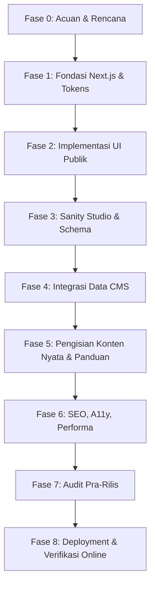

# Rencana Kerja Proyek (Phase 0–8) — Portofolio Fajri Alamsyah

Tanggal Dokumen: 24 Oktober 2026  
Status: Rencana Resmi Pelaksanaan  

Dokumen ini memetakan seluruh tahapan pengerjaan dari Fase 0 hingga Fase 8 beserta prasyarat, tugas pemilik, tugas agent, dan kriteria penyelesaian (Definition of Done) untuk setiap fase.

---

## Ringkasan Alur Fase

---

## Rincian Tiap Fase

### FASE 0: Persiapan Acuan, Dokumen, dan Aturan Kerja (Current)
- **Tujuan:** Menetapkan fondasi konseptual, arsitektur teknis, aturan kerja agent, token desain, inventaris aset, dan dokumen perencanaan.
- **Tugas Pemilik (Manual):**
  - Membuat folder proyek `portfolio-fajri`.
  - Meletakkan panduan di `docs/`.
  - Mengisi `inputs/content.md` dan menyiapkan aset bila sudah ada.
- **Tugas Agent:**
  - Memeriksa folder dan ketersediaan Node.js / aset nyata.
  - Membuat `AGENTS.md`, `docs/PROJECT_BRIEF.md`, `docs/DESIGN.md`, `docs/PLAN.md`, `docs/CONTENT_MODEL.md`, `docs/MANUAL_SETUP.md`, `docs/STATUS.md`, `CHANGELOG.md`.
  - Menyiapkan folder `inputs/` dan `.gitignore`.
- **Syarat Lanjut ke Fase 1:** Seluruh dokumen acuan lengkap, aturan kerja disepakati, dan inventaris bahan tercatat tanpa data palsu.

---

### FASE 1: Fondasi Next.js App Router dan Design Tokens
- **Tujuan:** Menginisialisasi aplikasi Next.js dengan App Router, TypeScript strict, Tailwind CSS, font Inter, dan struktur rute dasar.
- **Tugas Pemilik (Manual):**
  - Memastikan Node.js kompatibel (v24.12.0 sudah terpasang dan siap).
- **Tugas Agent:**
  - Inisialisasi/scaffold Next.js tanpa menghapus folder `docs/` atau `inputs/`.
  - Konfigurasi TypeScript strict dan Tailwind CSS dengan token warna resmi.
  - Menyiapkan layout dasar (`src/app/layout.tsx`), font Inter, dan kerangka rute publik (`/`, `/proyek`, `/proyek/[slug]`, `not-found.tsx`).
  - Menyiapkan script lint, typecheck, build, dan file `.env.example`.
- **Verifikasi & Deliverables:**
  - `npm run dev` berjalan tanpa error.
  - `npm run lint`, `npm run typecheck`, dan `npm run build` lulus 100%.
- **Syarat Lanjut ke Fase 2:** Fondasi aplikasi berjalan sempurna, kode bebas error lint/tipe, layout dasar sesuai tema navy.

---

### FASE 2: Implementasi Desain dan Antarmuka Publik
- **Tujuan:** Membangun seluruh tampilan antarmuka publik beranda, daftar proyek, dan studi kasus menggunakan data contoh lokal (fixtures) berlabel jelas.
- **Tugas Pemilik (Manual):**
  - Menaruh foto PNG asli ke `inputs/profile/` jika sudah siap.
  - Meninjau tampilan visual di desktop dan mobile.
- **Tugas Agent:**
  - Membangun komponen UI: Header/Navbar, Hero Section (komposisi teks, tombol CTA, latar PORTFOLIO, foto), Proyek Unggulan, Tentang, Keahlian, Kontak, Footer.
  - Membangun halaman `/proyek` (grid proyek) dan `/proyek/[slug]` (studi kasus mendalam).
  - Menggunakan fixture data lokal bertipe ketat (`src/data/mockProjects.ts`) dengan label placeholder yang jelas (misal: `[Nama Proyek]`).
  - Memastikan responsivitas sempurna pada 390px dan 1440px.
- **Verifikasi & Deliverables:**
  - Layout desktop dan mobile dapat dinilai dengan jelas.
  - Lint, typecheck, dan build lulus.
- **Syarat Lanjut ke Fase 3:** Desain publik disetujui, interaksi tombol berfungsi, tidak ada overflow atau cacat visual.

---

### FASE 3: Pembuatan Admin Sanity Studio dan Schema Konten
- **Tujuan:** Menyediakan antarmuka admin di `/studio` dengan schema konten berlabel Bahasa Indonesia dan validasi yang ketat.
- **Tugas Pemilik (Manual):**
  - Mendaftar/login ke akun Sanity.io.
  - Membuat proyek baru dan memilih dataset `production` (public).
  - Menyalin `Project ID` dan `Dataset` ke `.env.local`.
  - Menambahkan origin lokal (`http://localhost:3000`) ke CORS Sanity.
  - Melakukan login ke `/studio` di browser sendiri.
- **Tugas Agent:**
  - Mengonfigurasi Sanity Studio embedded di rute `/studio` menggunakan `next-sanity`.
  - Membuat schema 4 jenis dokumen: Profil (singleton), Proyek, Keahlian, Pengaturan Situs (singleton).
  - Memberikan label, deskripsi field, dan aturan validasi dalam Bahasa Indonesia.
  - Menyiapkan instruksi langkah demi langkah di `docs/MANUAL_SETUP.md`.
- **Verifikasi & Deliverables:**
  - Rute `/studio` dapat dibuka dan menampilkan formulir sesuai schema.
  - Lint, typecheck, dan build lulus.
- **Syarat Lanjut ke Fase 4:** Pemilik berhasil login ke Studio dan formulir siap menerima pengisian data.

---

### FASE 4: Integrasi Data Sanity ke Halaman Publik
- **Tujuan:** Menghubungkan seluruh halaman publik website dengan data dari Sanity Content Lake secara dinamis.
- **Tugas Pemilik (Manual):**
  - Memasukkan profil dasar dan minimal satu proyek nyata sebagai draft di Studio untuk pengujian.
  - Menekan tombol **Publish** saat siap diuji.
- **Tugas Agent:**
  - Membuat query GROQ terpusat dengan parameter aman dan tipe TypeScript.
  - Mengonfigurasi pengambilan data server dengan `perspective: 'published'`, `useCdn: false`, dan strategi tanpa cache lintas request (`cache: 'no-store'`).
  - Mengganti mock fixture lokal dengan adapter data Sanity.
  - Menangani kondisi data kosong (empty state), error connection fallback, dan konfigurasi next/image untuk domain Sanity.
- **Verifikasi & Deliverables:**
  - Data yang dipublish di Sanity langsung muncul di website setelah refresh tanpa rebuild.
  - Dokumen draft tidak bocor ke publik.
  - Proyek dengan `tampilkan: false` tidak muncul di halaman publik.
- **Syarat Lanjut ke Fase 5:** Integrasi data terbukti bekerja langsung, build tetap lulus.

---

### FASE 5: Pengisian Konten Nyata dan Panduan Pengelolaan
- **Tujuan:** Membantu pemilik mengisi data fakta portofolio ke CMS dan menyediakan panduan admin lengkap.
- **Tugas Pemilik (Manual):**
  - Mengisi data Profil, CV PDF, Foto PNG asli, Keahlian, Proyek nyata, dan Kontak melalui `/studio`, lalu menekan **Publish**.
- **Tugas Agent:**
  - Membantu menyusun kalimat studi kasus dari bahan `inputs/content.md` tanpa mengarang fakta.
  - Membuat panduan admin lengkap di `docs/PANDUAN_ADMIN.md` (cara edit, publish, unpublish, backup data CLI).
  - Melakukan audit data publik: memastikan tidak ada dummy atau teks template tersisa.
- **Verifikasi & Deliverables:**
  - Halaman publik menampilkan data fakta asli Fajri.
  - Tombol Unduh CV mengunduh file PDF yang benar.
- **Syarat Lanjut ke Fase 6:** Seluruh konten utama nyata telah terbit dan diverifikasi.

---

### FASE 6: Optimasi SEO, Aksesibilitas, dan Performa
- **Tujuan:** Memaksimalkan kualitas website dari sisi mesin pencari, aksesibilitas pengguna, dan kecepatan muat halaman.
- **Tugas Pemilik (Manual):**
  - Meninjau teks deskripsi dan gambar Open Graph.
- **Tugas Agent:**
  - Konfigurasi Dynamic Metadata (title, description, canonical, open graph, twitter card).
  - Pembuatan `sitemap.ts` dan `robots.ts` otomatis (dengan pengecualian rute `/studio`).
  - Audit aksesibilitas: heading order, ARIA attributes, kontras warna, keyboard navigation, reduced motion.
  - Optimasi aset gambar (priority, sizes, format webp/avif via Next.js image optimizer).
- **Verifikasi & Deliverables:**
  - Audit Lighthouse / pemeriksaan browser menunjukkan metrik tinggi pada Performa, SEO, dan Aksesibilitas.
  - Lint, typecheck, dan build lulus.
- **Syarat Lanjut ke Fase 7:** Seluruh aspek SEO dan aksesibilitas terverifikasi tanpa regresi fungsional.

---

### FASE 7: Audit Menyeluruh Pra-Rilis
- **Tujuan:** Melakukan pemeriksaan ketat terhadap keamanan, privasi data, konsistensi UI, dan ketiadaan mock data sebelum kode dimasukkan ke Git/GitHub.
- **Tugas Pemilik (Manual):**
  - Memeriksa checklist akhir yang dibuat agent.
- **Tugas Agent:**
  - Menjalankan audit menyeluruh: tidak ada secret/token di client, folder inputs/backups tidak masuk git, tidak ada link palsu `#`, zero dummy/placeholder.
  - Menguji production build lokal (`npm run build && npm run start`).
  - Membuat dokumen `docs/RELEASE_CHECKLIST.md` berisi status empiris: `LULUS`, `PERLU PERBAIKAN`, atau `BELUM DIVERIFIKASI`.
- **Verifikasi & Deliverables:**
  - Seluruh item kritis pada `RELEASE_CHECKLIST.md` berstatus `LULUS`.
- **Syarat Lanjut ke Fase 8:** Proyek dinyatakan layak rilis dan siap dimasukkan ke repositori Git.

---

### FASE 8: Panduan Deployment dan Verifikasi Online
- **Tujuan:** Memandu pemilik melakukan push ke GitHub, setup hosting di Vercel, konfigurasi domain, serta memverifikasi situs yang aktif secara online.
- **Tugas Pemilik (Manual):**
  - Menginisialisasi repositori Git lokal dan remote GitHub (pribadi/organisasi).
  - Menghubungkan repo ke akun Vercel.
  - Mengisi Environment Variables di dashboard Vercel (`NEXT_PUBLIC_SANITY_PROJECT_ID`, `NEXT_PUBLIC_SANITY_DATASET`, dll.).
  - Menambahkan domain hosting ke konfigurasi CORS Sanity.
  - Memberikan URL online kepada agent untuk verifikasi.
- **Tugas Agent:**
  - Membuat panduan deployment lengkap di `docs/DEPLOYMENT.md`.
  - Memeriksa URL online yang diberikan: status HTTP 200, aset termuat, studi kasus terbuka, responsivitas live.
  - Memperbarui checklist rilis dengan bukti nyata dari URL online.
- **Verifikasi & Deliverables:**
  - Website portofolio aktif di internet dan dapat diakses publik dengan sempurna.
  - Dokumentasi final diperbarui di `docs/STATUS.md` dan `CHANGELOG.md`.
